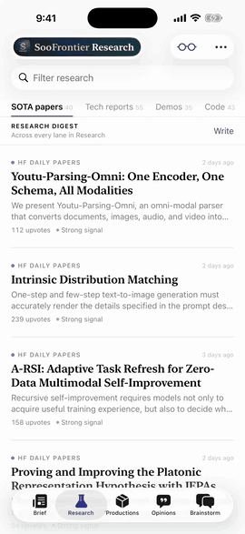
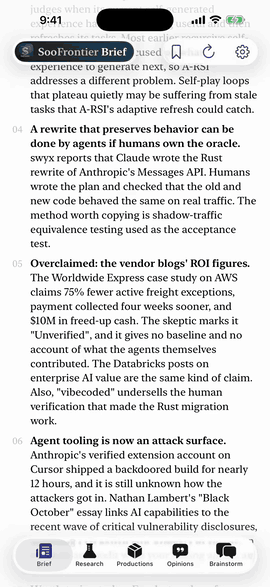
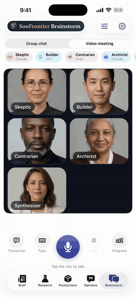
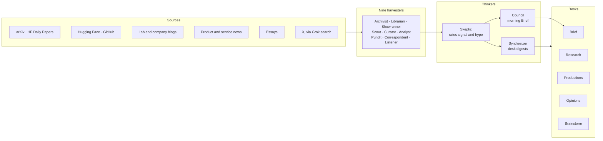
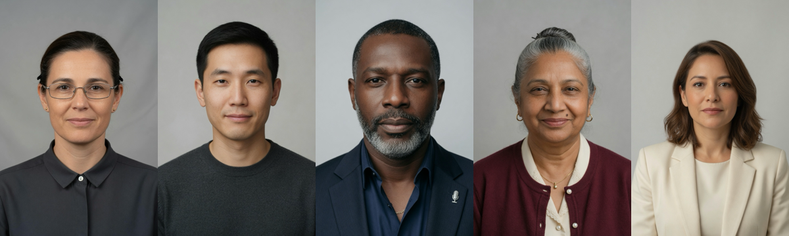
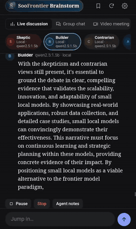
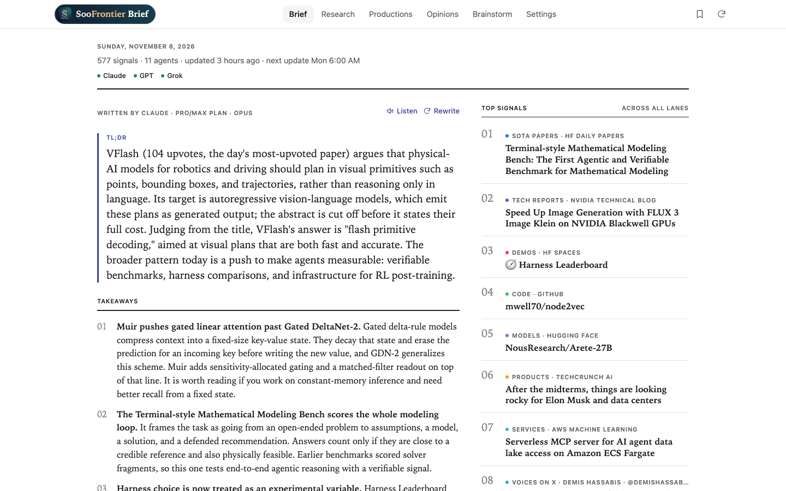
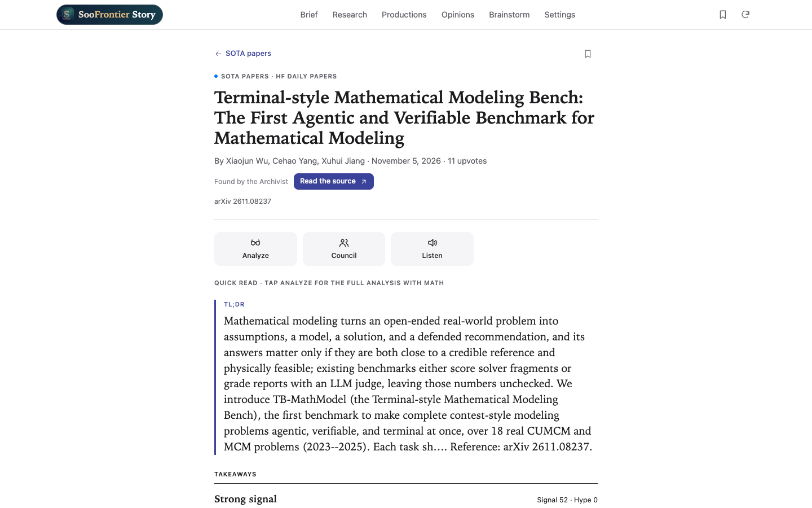
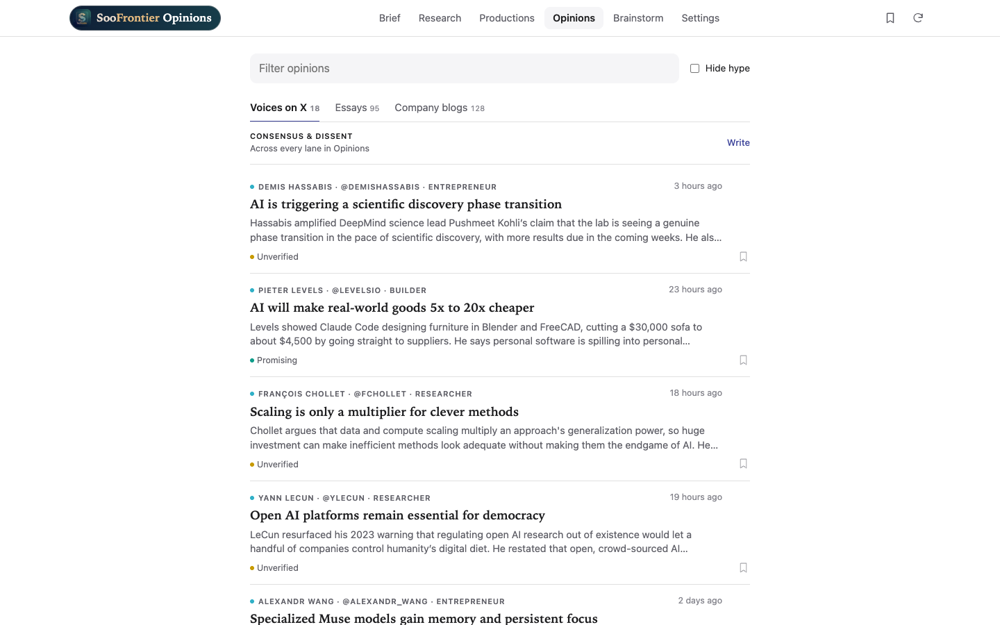

<p align="center">
  
</p>

<h1 align="center">SooFrontier</h1>

<p align="center">
  A crew of AI agents that reads the AI frontier for you, every morning.<br>
  Mac · iPhone · iPad · Web
</p>

For people who work on AI: papers, tech reports, demos, code, models, products, essays, company blogs and voices on X, gathered, checked and summarized in one place.

## Demos

Recorded on iPhone. Click a preview to watch the full video; the longer ones are sped up here.

| Brief | Research | Opinions | Video meeting |
| :---: | :---: | :---: | :---: |
| [](design/demo/brief.mp4) | [](design/demo/research.mp4) | [](design/demo/opinions.mp4) | [](design/demo/meeting.mp4) |
| The day's read, written by the Council | From a paper list to a structured read | What the people you follow are saying | Panelists speak their answers |

## How it works



Every morning at 6:00 am Pacific the harvesters run in parallel and publish as they finish. The Skeptic dedupes and scores each story, then the Synthesizer and the Council write on top of the harvest.

## What it does

- **Eleven agents.** Nine harvesters pull from arXiv, Hugging Face, GitHub, lab and company blogs, product news and X (through Grok search). The Skeptic rates each story and flags hype, and the Synthesizer writes each desk's digest.
- **Five desks.** Brief, Research, Productions, Opinions and Brainstorm, each with lanes, a filter, a digest you can listen to, and Previous / Next paging.
- **The Frontier Council.** Five members (Skeptic, Builder, Contrarian, Open-Weights Advocate and Edge Engineer) debate a story on your local models, at no plan or API cost. Each seat can have its own model; the Edge Engineer is played by [LiquidAI LFM3-1.7B](https://huggingface.co/LiquidAI/LFM3-1.7B) (`ollama pull hf.co/LiquidAI/LFM3-1.7B-GGUF:BF16`). After opening statements they rebut each other by name in rounds until they all hold the same verdict (read, try, wait or skip), up to four rounds, then a moderator rules.
- **A structured read of every story.** A quick read (contributions, findings, results, limitations, opportunities), plus key figures from the paper.
- **Brainstorm.** A group chat or a video meeting with five model panelists (Skeptic, Builder, Contrarian, Archivist, Synthesizer) whose faces speak their answers, rendered on device with MediaPipe face landmarks.
<p align="center">
  
</p>

- **Live discussion (browser version only).** Type a topic and the same five panelists debate it on your local models until you stop them, streaming as they write. Each has its own model and characteristic, which you change by clicking it, plus private notes that keep prompts small. You can jump in, pause and resume, and set the reply length, pace and memory. See [the browser version](web/README.md#live-discussion).

<p align="center">
  <a href="web/README.md#live-discussion"></a>
</p>

- **A daily rhythm.** A fresh harvest at 6:00 am Pacific, and read-aloud that keeps going on the lock screen.

## Models

Each provider runs either on a plan you already pay for, through its official CLI on the Mac (`claude`, `codex`, `grok`), or on an API key. iPhone and iPad can pair with a Mac on the same network and use its plans.

### Local models on your own GPU

Open-weight models can run on your own machine, such as an NVIDIA DGX Spark / GB10 with 128 GB, through [Ollama](https://ollama.com). The Council, Brainstorm and Live discussion run only on them. They also write whenever Claude, GPT or Grok can't be reached, or answer first when **Prefer local models** is on. Live X and web research always goes to Grok.

| Role | Default | Why |
| --- | --- | --- |
| Main model: brief, analyses, Council rulings | `gpt-oss:120b` | The strongest open model that fits in 128 GB (about 65 GB) |
| Fast model: quick reads | `qwen3.6:35b-a3b` | Mixture of experts with 3B active parameters, so it's quick on the GB10's memory bandwidth |

On the GPU box:

```bash
ollama pull gpt-oss:120b
ollama pull qwen3.6:35b-a3b
# Listen beyond localhost so iPhone, iPad and the Mac can reach it
sudo systemctl edit ollama   # add: Environment="OLLAMA_HOST=0.0.0.0:11434"
```

In **Settings → Local models**, enter the server's address: its LAN IP (`http://192.168.1.20:11434`), its `.local` name, or its IP on a VPN like Tailscale (`http://100.x.y.z:11434`) to use it away from home. iOS allows plain HTTP only to local names and IP addresses; for a full hostname such as a Tailscale MagicDNS name, serve it over HTTPS (`tailscale serve --bg 11434`). Ollama has no sign-in, so keep it on your LAN or VPN and don't forward the port to the internet.

## Building the apps

Requires Xcode 16 or newer, iOS 18 and macOS 15. The project is generated from `project.yml` with [XcodeGen](https://github.com/yonaskolb/XcodeGen), and the generated project is checked in.

```bash
open SooFrontier.xcodeproj
```

Set your own team under Signing & Capabilities (or `DEVELOPMENT_TEAM` in `project.yml`) before running on a device.

## The browser version

Lives in [`web/`](web/README.md): a zero-dependency Node 22 server plus a plain JavaScript UI.

```bash
cd web
node server.mjs
```

Then open http://localhost:5180. To run the tests, `cd web && npm test`; they use a fake model server, so they need no network or GPU box.



| A story page | Opinions |
| :---: | :---: |
|  |  |

## Layout

| Path | What's there |
| --- | --- |
| `SooFrontier/Agents` | Harvesters and thinkers |
| `SooFrontier/Services` | Feeds, model access, CLI runner, Mac bridge, local model server |
| `SooFrontier/Store` | App state, daily refresh, appearance |
| `SooFrontier/Views`, `Brainstorm` | The desks, story pages and the meeting room |
| `SooFrontier/Resources` | The video meeting stage and panelist portraits |
| `web` | The browser version: `lib` is the server logic, `public` the UI, `test` the smoke tests |
| `design` | App icon sources and demo recordings |
| `docs/media` | README previews and screenshots |

## License

[MIT](LICENSE)
