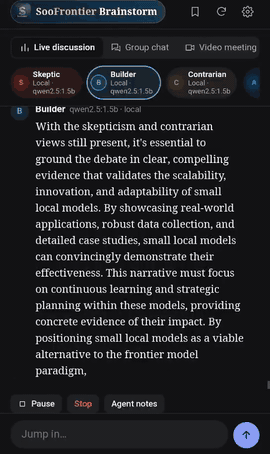

# SooFrontier for the browser

The same crew, desks, and Brainstorm panel as the native app, in any browser. A small Node server does what a browser can't: it fetches the feeds and runs your models. It needs Node 22 or newer and installs nothing else.

```bash
cd web
node server.mjs
```

Then open http://localhost:5180. If the cache is empty, or it predates the latest 6:00 am Pacific, the crew goes out right away.

## Models

Settings works as it does on the Mac. Each provider runs either on your plan, through its official CLI (`claude`, `codex`, `grok`), or on a metered API key. Plans need the CLI signed in on the computer running this server.

## Live discussion

Brainstorm → **Live discussion** is a roundtable that never ends. Type a topic and five agents (Skeptic, Builder, Contrarian, Archivist and Synthesizer) debate it on your local models until you press Stop. Replies stream in token by token.

<p align="center">
  
</p>

- **Jump in.** Type in the box at the bottom and the next agents answer you first.
- **Pause, Resume, Stop.** A discussion survives a restart and comes back paused.
- **One agent.** Click an agent's chip to change its model and its characteristic, the persona it speaks from. It applies from that agent's next turn, which comes up next, and a note in the transcript records the change. Its private notes start again, so the old character doesn't pull it back. An agent with no choice of its own uses the main local model.
- **Private notes.** Each agent keeps its own notes, rewritten every few turns on its own model, so prompts stay small enough for a short context window. **Agent notes** shows them.
- **Settings chip.** Reply length (Short, Medium, Long), Pace (Full speed, Relaxed, Slow) and Memory, how many recent turns each agent sees (Short, Normal, Long). Each applies from the next turn. What an agent remembers is also capped by size, so prompts fit a small model's context window.
- **Repetition.** A reply that mostly repeats recent turns is asked for again once, and if it still repeats, the Synthesizer opens a new angle.

A new topic keeps each agent's model and characteristic and your settings, and starts with clean notes. It needs Local models set up in Settings, with the main model downloaded. The choices, their values, the starter topics and the speaking order are data in `public/live-config.json`.

## What's stored where

- `~/.soofrontier-web/settings.json`: API keys, saved stories, voices, roles. Readable only by your user. Keys are never sent to the browser.
- `~/.soofrontier-web/cache.json`: the harvest, brief, digests, and quick reads.
- `~/.soofrontier-web/live-room.json`: the current Live discussion: its topic, turns, each agent's model, characteristic and notes, and the settings.
- Appearance and Brainstorm options stay in each browser.

Set `SOOFRONTIER_DATA` to keep these somewhere else.

## Reaching it from another device

By default the server only answers this computer. Anyone who reaches it can spend your plan, so anything wider requires an access code, which is printed at startup (or set your own with `SOOFRONTIER_CODE`):

```bash
HOST=0.0.0.0 node server.mjs
```

This serves plain HTTP, so only use it on a network you trust. Browsers also turn off the microphone on plain HTTP, except on localhost; for voice on another device, put the server behind HTTPS.

## Differences from the native apps

- **Refresh:** the 6:00 am Pacific refresh runs on the server, so it happens only while the server is running. It catches up as soon as it next runs or the computer wakes.
- **Mac bridge:** native only. Here, models run where the server runs, or on your local model server.
- **Local models:** point Settings → Local models at an Ollama server (default `http://localhost:11434`, or set `SOOFRONTIER_LOCAL_URL`). The Council and Brainstorm run only on it.
- **Live discussion:** browser only. The native apps have Group chat and Video meeting but no Live discussion.
- **Listening:** read-aloud uses the browser's voices. It has no lock-screen controls, and may stop when a phone browser goes to the background.
- **Voice input:** needs Chrome or Safari. Other browsers can still type.
- **Video meeting:** uses the native app's stage, read from `../SooFrontier/Resources`, so keep the `web` folder next to it.

## Tests

```bash
cd web
npm test
```

This starts the real server against a fake Ollama, with a throwaway data folder, so it needs no network, no GPU box and none of your saved data. It covers the pages and state, streaming, changing an agent, the discussion settings, and pause and resume. It uses Node's built-in test runner, so it installs nothing.

Setting `SOOFRONTIER_NO_REFRESH=1` makes the server skip fetching the feeds on start; the tests use it.
